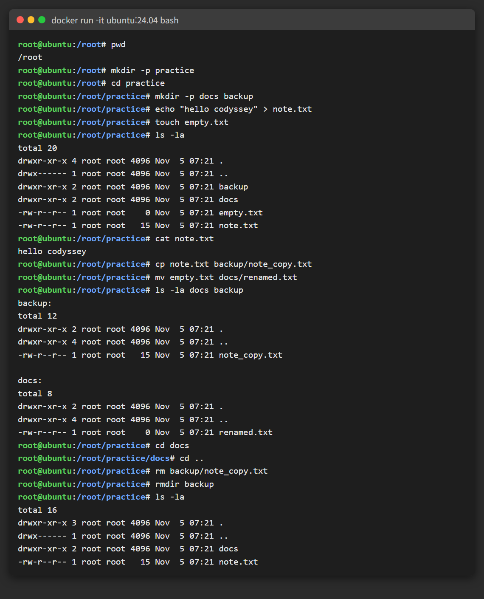
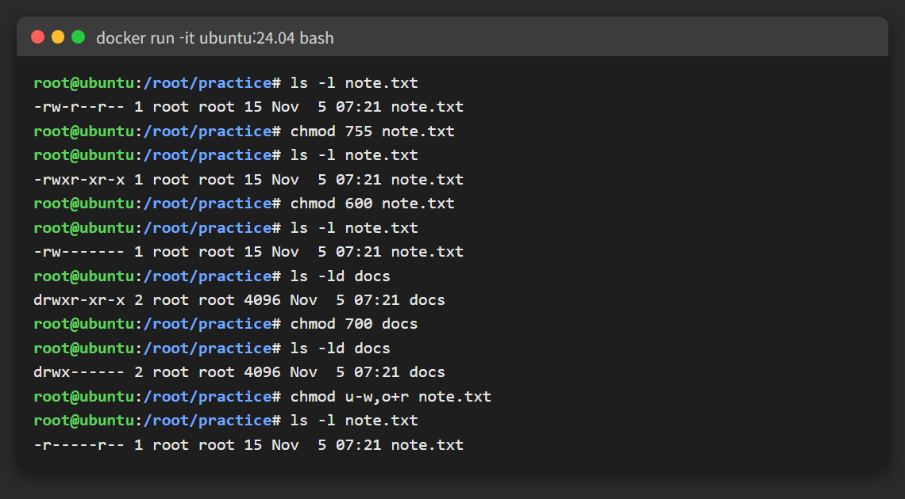
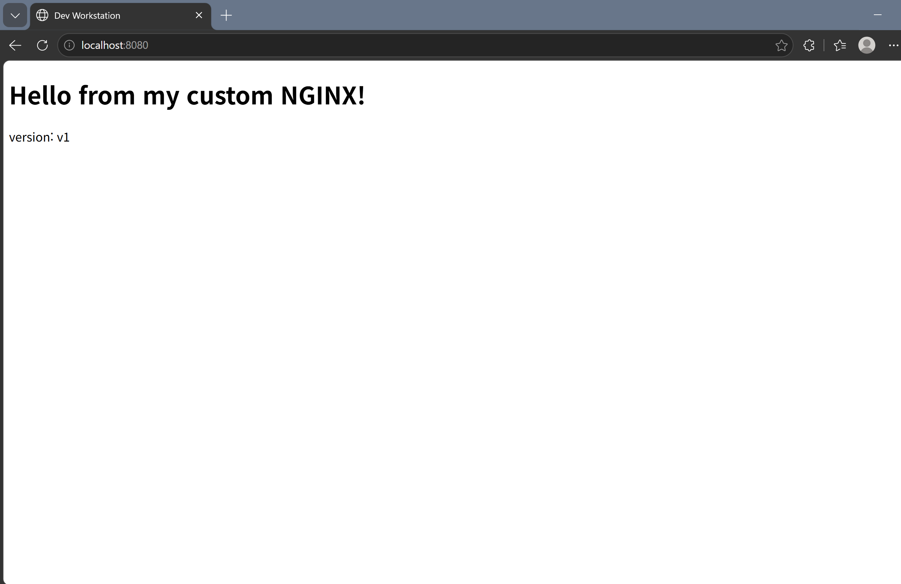
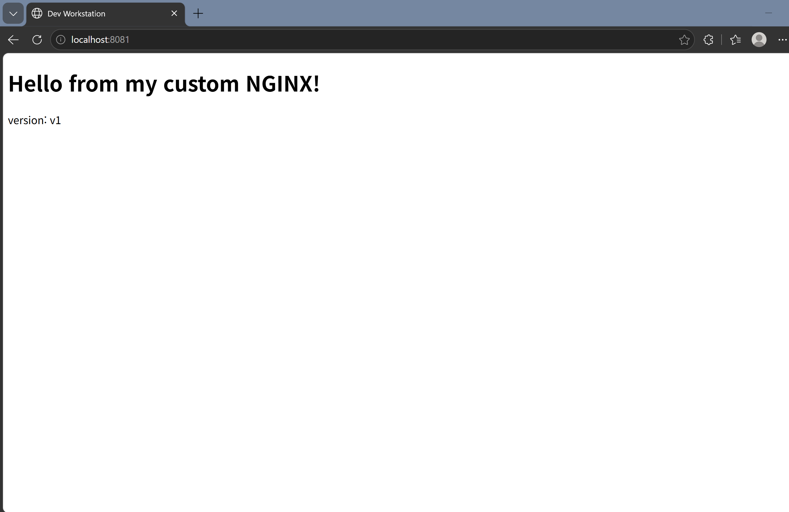
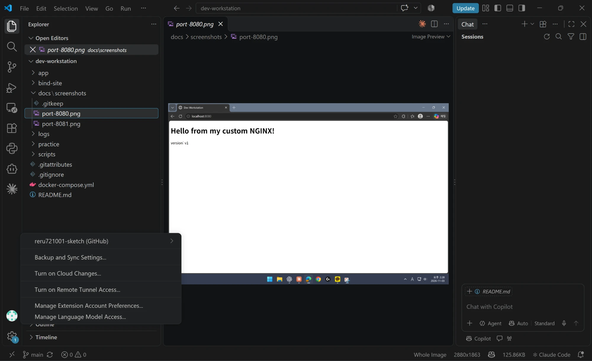

# 미션 E1-1 : 내 컴퓨터에 개발자용 '작업실' 꾸미기

## 📌 개요
- **목표:** 터미널·권한을 다뤄 보고, Docker로 내 웹 서버 이미지를 만들어 실행한 뒤, Git으로 GitHub에 올린다.
- **증거:** 모든 실행 결과는 `logs/` 에 텍스트로 남겼고, `scripts/` 를 실행하면 같은 결과를 다시 얻을 수 있다.

| 항목 | 값 |
|---|---|
| OS | Windows 11 Pro |
| 쉘 | Git Bash (bash 5.3) |
| Docker | Docker Desktop 4.97.0 (Engine 29.9.2) |
| Git | 2.56.0 |

## ✅ 체크리스트 · 검증 방법
| 항목 | 확인한 명령 | 확인한 것 | 결과 |
|---|---|---|---|
| ✅ 터미널 | `mkdir`, `cp`, `mv`, `rm`, `ls` | 파일·폴더 만들기/복사/이동/삭제 | [1.](#1-터미널-조작), [로그](logs/01_terminal_perm.txt) |
| ✅ 권한 | `chmod`, `ls -l` | 바꾸기 전/후 비교 | [2.](#2-권한-변경-전후-비교), [로그](logs/01_terminal_perm.txt) |
| ✅ Docker 설치 | `docker --version`, `docker info` | 설치·실행 여부 | [3.](#3-docker-설치-점검), [로그](logs/02_docker.txt) |
| ✅ Docker 운영 | `images`, `ps -a`, `logs`, `stats` | 이미지·컨테이너 상태 | [4.](#4-docker-기본-운영), [로그](logs/02_docker.txt) |
| ✅ Dockerfile | `docker build`, `docker run` | 내 페이지가 뜨는지 | [5.](#5-커스텀-이미지-제작), [로그](logs/02_docker.txt) |
| ✅ 포트 | `-p 8080:80`, `-p 8081:80` | 브라우저 접속 | [6.](#6-포트-매핑) |
| ✅ 바인드 마운트 | `-v 폴더:경로` | 수정 전/후 비교 | [7-1.](#7-1-바인드-마운트-재빌드-없이-수정-반영), [로그](logs/02_docker.txt) |
| ✅ 볼륨 | `docker volume` | 삭제 전/후 비교 | [7-2.](#7-2-볼륨-컨테이너를-지워도-데이터-유지), [로그](logs/02_docker.txt) |
| ✅ Git / GitHub | `git config`, `git remote`, `git push` | 설정·연동 | [8.](#8-git-설정-및-github-연동) |
| ✅ (보너스) Compose | `docker compose` | 컨테이너 2개 동시 실행 | [10.](#10-보너스--docker-compose), [로그](logs/03_compose.txt) |

---

## 프로젝트 디렉토리 구성
```
test-e1-1/
├── app/
│   ├── Dockerfile          # 이미지 빌드 정의서
│   └── site/index.html     # 내 웹페이지
├── scripts/                # 실습 명령 (01~04 순서대로 실행)
├── logs/                   # 실행 결과 (스크립트와 같은 번호)
├── docs/screenshots/       # 브라우저·VSCode 화면
├── docker-compose.yml      # 보너스: 컨테이너 2개 실행 설정
└── README.md
```
| 폴더/파일 | 역할 |
|---|---|
| `app/` | "무엇을 담은 이미지인지" (소스 + Dockerfile) |
| `scripts/` | "무엇을 실행했는지" |
| `logs/` | "결과가 어땠는지" |
| `docker-compose.yml` | "어떻게 실행할지" |

---

## 1. 터미널 조작
```bash
$ mkdir -p docs backup                  # docs, backup 폴더 2개 만들기 (-p: 이미 있어도 오류 없음)
$ echo "hello codyssey" > note.txt      # 글자를 note.txt에 써서 새 파일 만들기
$ ls -la                                # 지금 폴더 목록 보기 (-l: 자세히, -a: 숨김 파일 포함)
drwxr-xr-x  backup                      # d로 시작 = 폴더
drwxr-xr-x  docs                        # d로 시작 = 폴더
-rw-r--r--  note.txt                    # -로 시작 = 파일
$ cp note.txt backup/note_copy.txt      # note.txt를 backup 폴더에 note_copy.txt로 복사
$ mv note.txt docs/renamed.txt          # note.txt를 docs 폴더로 옮기면서 이름도 renamed.txt로 바꿈
$ rm backup/note_copy.txt               # 복사본 삭제
```
| 경로 | 뜻 | 예시 |
|---|---|---|
| 절대 경로 | `/` 부터 전부 적은 경로. 어디서든 같은 곳 | `/home/user/docs` |
| 상대 경로 | 지금 위치 기준. 위치에 따라 달라짐 | `../docs` |

📸 **실행 화면** (우분투 컨테이너에서 실행)



📄 전체 로그: [logs/01_terminal_perm.txt](logs/01_terminal_perm.txt)

---

## 2. 권한 (변경 전/후 비교)
> Windows는 리눅스 권한을 지원하지 않아서 **우분투 컨테이너 안에서** 실습했다.

```bash
$ ls -l f.txt     -rw-r--r--  f.txt    # 파일 권한 확인: 변경 전 644 (나 읽기·쓰기 / 나머지 읽기만)
$ chmod 755 f.txt                      # 권한을 755로 바꿈 (나 전부 / 나머지 읽기·실행)
$ ls -l f.txt     -rwxr-xr-x  f.txt    # 다시 확인: 변경 후 755 (x가 생김 = 실행 가능)

$ ls -ld d        drwxr-xr-x  d        # 폴더 권한 확인 (-d: 폴더 안 말고 폴더 자신): 변경 전 755
$ chmod 700 d                          # 폴더를 700으로 바꿈 (나만 전부, 나머지는 아무것도 못 함)
$ ls -ld d        drwx------  d        # 다시 확인: 변경 후 700
```

📸 **실행 화면** — 파일 `644 → 755 → 600`, 폴더 `755 → 700`, 기호 방식(`u-w,o+r`)까지



> 맨 앞 글자는 종류: `-` = 파일, `d` = 폴더(directory). 폴더는 `ls -ld` 로 봐야 폴더 자신의 권한이 나온다.

### 권한 숫자 ↔ 글자
| 숫자 | 2진수 | 글자 | 의미 |
|---|---|---|---|
| 7 | 111 | `rwx` | 읽기+쓰기+실행 |
| 6 | 110 | `rw-` | 읽기+쓰기 |
| 5 | 101 | `r-x` | 읽기+실행 |
| 4 | 100 | `r--` | 읽기 |
| 0 | 000 | `---` | 없음 |

> 읽기(4) + 쓰기(2) + 실행(1)을 더한 값. 세 자리는 **나 / 그룹 / 다른 사람** 순서.
> 예: `755` = 나 `rwx`(7) / 그룹 `r-x`(5) / 다른 사람 `r-x`(5)

---

## 3. Docker 설치 점검
```bash
$ docker --version                   # Docker가 설치됐는지, 버전 확인
Docker version 29.9.2, build a82e528 # 설치돼 있음
$ docker info                        # Docker 엔진(데몬)이 켜져 있는지 확인
Server Version: 29.9.2               # Server 정보가 나오면 엔진이 켜져 있다는 뜻
$ docker run --rm hello-world        # 테스트용 이미지 실행 (--rm: 끝나면 컨테이너 자동 삭제)
Hello from Docker!                   # 이 문구가 나오면 Docker 정상 동작
```

---

## 4. Docker 기본 운영

### 이미지 vs 컨테이너
| | 이미지 | 컨테이너 |
|---|---|---|
| 한 줄 정의 | 실행에 필요한 걸 묶은 **설계도** | 설계도로 **실행한 것** |
| 바뀌나 | 안 바뀜 (읽기 전용) | 실행 중에 바뀔 수 있음 |
| 만드는 법 | `docker build` | `docker run` |
| 예시 | `my-web:1.0` 1개 | `my-web-8080`, `my-web-8081` 2개 |

> 이미지 하나로 컨테이너를 여러 개 띄울 수 있다.

```bash
$ docker images            # 내 PC에 있는 이미지 목록
hello-world   25.9kB       # 이미지 이름과 용량
ubuntu        119MB
$ docker ps -a             # 컨테이너 목록 (-a: 꺼진 것까지 전부)
my-web-8080   Up (healthy)   0.0.0.0:8080->80/tcp   # Up = 실행 중, healthy = 상태 검사 통과, PC 8080 → 컨테이너 80
my-web-8081   Up (healthy)   0.0.0.0:8081->80/tcp   # 같은 이미지로 하나 더 띄운 것 (PC 8081)
$ docker logs my-web-8080  # 이 컨테이너가 남긴 기록 보기
"GET / HTTP/1.1" 200       # 누가 페이지를 요청했고 200(성공)으로 응답했다는 기록
$ docker stats --no-stream # 컨테이너별 CPU·메모리 사용량 (--no-stream: 한 번만 출력)
my-web-8080   CPU 0.00%   MEM 14.97MiB   # CPU 거의 0%, 메모리 약 15MB 사용
```

### attach vs exec
| | attach | exec |
|---|---|---|
| 하는 일 | 컨테이너의 **메인 프로그램**에 연결 | **새 프로그램**을 하나 더 실행 |
| `exit` 하면 | 컨테이너 **꺼짐** | 컨테이너 **계속 실행** |

📄 전체 로그: [logs/02_docker.txt](logs/02_docker.txt), [logs/04_attach_exec.txt](logs/04_attach_exec.txt)

---

## 5. 커스텀 이미지 제작

### 베이스 선택
> **방식 (A):** nginx 베이스 이미지 + 내 웹페이지(index.html)로 교체

| 적용 내용 | 목적 |
|---|---|
| `FROM nginx:1.27-alpine` | 버전을 고정해서 언제 빌드해도 같은 결과. alpine이라 용량이 작음 |
| `COPY site/ ...` | 내 웹페이지를 이미지에 넣음 |
| `HEALTHCHECK` | `docker ps` 에서 healthy/unhealthy 로 상태 확인 |
| `ENV APP_ENV=dev` | 설정을 코드와 분리 |

### Dockerfile ([app/Dockerfile](app/Dockerfile))
```dockerfile
# nginx(웹 서버) 1.27 버전, 가벼운 alpine 리눅스 기반 이미지에서 시작
FROM nginx:1.27-alpine
# 이미지에 이름표(설명) 붙이기
LABEL org.opencontainers.image.title="my-custom-nginx"
# 환경변수 APP_ENV를 dev로 설정 (개발용이라는 표시)
ENV APP_ENV=dev
# 내 PC의 site 폴더(내 웹페이지)를 nginx가 보여 주는 폴더로 복사
COPY site/ /usr/share/nginx/html/
# 10초마다 내 페이지가 열리는지 검사, 3초 안에 응답 없으면 실패, 3번 연속 실패하면 unhealthy
HEALTHCHECK --interval=10s --timeout=3s --retries=3 \
  CMD wget -qO- http://localhost/ >/dev/null || exit 1
# 이 컨테이너는 80번 포트를 쓴다고 적어 둠 (표시용, 실제 연결은 -p로 함)
EXPOSE 80
```

### COPY 경로 규칙
```dockerfile
COPY site/ /usr/share/nginx/html/
#    └ 상대경로 (빌드 폴더 app/ 기준)  └ 절대경로 (컨테이너 안)
```

### 빌드 / 실행
```bash
$ docker build -t my-web:1.0 ./app                        # app 폴더의 Dockerfile로 이미지 만들기 (-t: 이름 my-web, 버전 1.0)
naming to docker.io/library/my-web:1.0 done             # 이미지 만들기 완료
$ docker run -d -p 8080:80 --name my-web-8080 my-web:1.0 # 이미지로 컨테이너 실행 (-d: 백그라운드, -p: PC 8080 → 컨테이너 80, --name: 이름)
$ curl http://localhost:8080                            # 내 PC 8080으로 접속해서 페이지 내용 받아 오기
<h1>Hello from my custom NGINX!</h1>                    # 내가 만든 index.html이 나옴 = 성공
```

> **수정 흐름:** 실행 중인 컨테이너를 고치는 게 아니라
> `index.html` 수정 → `docker build`(새 이미지) → 기존 컨테이너 삭제 → `docker run`(새 컨테이너)
> 컨테이너 안에서 직접 고친 내용은 컨테이너를 지우면 사라지기 때문이다.

---

## 6. 포트 매핑
### 왜 필요한가
- 컨테이너는 **자기만의 네트워크(IP, 포트)** 를 따로 가진다. (네트워크 네임스페이스)
- 그래서 컨테이너 안 nginx가 80번에서 돌아가도 내 PC에서는 안 보인다.
- `-p 8080:80` 으로 **내 PC 8080 → 컨테이너 80** 을 연결해 줘야 접속된다.

| 실행 방법 | `docker ps` PORTS 칸 | 브라우저 접속 |
|---|---|---|
| `docker run -d my-web:1.0` (`-p` 없음) | `80/tcp` | ❌ 안 됨 |
| `docker run -d -p 8080:80 my-web:1.0` | `0.0.0.0:8080->80/tcp` | ✅ `localhost:8080` |

> 같은 이미지라도 내 PC 포트만 다르게(8080, 8081) 주면 여러 개를 동시에 띄울 수 있다.




---

## 7. 바인드 마운트 vs 볼륨
| | 바인드 마운트 | 볼륨 |
|---|---|---|
| 저장 위치 | 내 PC 폴더 (내가 지정) | Docker가 관리하는 공간 |
| 장점 | PC에서 바로 수정·확인 (개발용) | 컨테이너를 지워도 유지 (운영용) |
| 단점 | PC 폴더 경로에 따라 달라짐 | 파일을 직접 열어 보기 불편 |

### 7-1. 바인드 마운트: 재빌드 없이 수정 반영
```bash
$ docker run -d -p 8082:80 -v "$PWD/bind-site":/usr/share/nginx/html nginx:1.27-alpine
#   └ -v 내PC폴더:컨테이너폴더 → 내 PC의 bind-site 폴더를 컨테이너 웹페이지 폴더에 그대로 연결
$ curl localhost:8082                         # 수정 전 페이지 확인
version: v1                                   # 처음 내용 v1
$ sed -i "s/v1/v2/" bind-site/index.html      # 내 PC 파일에서 v1을 v2로 바꿈 (컨테이너는 안 건드림)
$ curl localhost:8082                         # 다시 확인
version: v2                                   # 다시 빌드 안 했는데 바로 v2 = 폴더가 연결돼 있다는 증거
```

### 7-2. 볼륨: 컨테이너를 지워도 데이터 유지
```bash
# 1. 볼륨 생성
$ docker volume create mydata                 # Docker가 관리하는 저장 공간 mydata 만들기
# 2. 컨테이너에 연결 + 데이터 작성
$ docker run -d --name vol-test -v mydata:/data ubuntu sleep infinity   # mydata를 컨테이너 /data에 연결 (sleep infinity: 안 꺼지게 계속 켜 둠)
$ docker exec vol-test sh -c "echo hi > /data/hello.txt"                # 컨테이너 안에서 /data/hello.txt에 hi 저장
# 3. 컨테이너 삭제
$ docker rm -f vol-test                       # 컨테이너 강제 삭제 (-f: 켜져 있어도 삭제)
# 4. 새 컨테이너에서 확인
$ docker run -d --name vol-test2 -v mydata:/data ubuntu sleep infinity  # 새 컨테이너에 같은 볼륨 연결
$ docker exec vol-test2 cat /data/hello.txt   # 파일 내용 읽기
hi                                            # 컨테이너를 지웠는데도 데이터가 남아 있음
```
> ✅ 컨테이너 삭제 후에도 **데이터 유지됨** 확인

---

## 8. Git 설정 및 GitHub 연동
```bash
$ git config --global user.name "손건"              # 커밋에 남길 내 이름 설정 (--global: 이 PC 전체에 적용)
$ git config --global user.email "****@icloud.com"   # 커밋에 남길 내 이메일 설정
$ git config --global init.defaultBranch main        # 새 저장소의 기본 브랜치 이름을 main으로
$ git config --list                                  # 설정한 값 확인
user.name=손건                                       # 이름 들어감
user.email=****@icloud.com                           # 이메일 들어감
init.defaultbranch=main                              # 기본 브랜치 main
```
**GitHub 원격 저장소 연결**
```bash
$ git remote add origin https://github.com/reru721001-sketch/test-e1-1.git   # 내 PC 저장소에 GitHub 주소를 origin이라는 이름으로 등록
$ git remote -v                                                             # 등록된 주소 확인
origin	https://github.com/reru721001-sketch/test-e1-1.git (fetch)          # 받아 올 때 쓰는 주소
origin	https://github.com/reru721001-sketch/test-e1-1.git (push)           # 올릴 때 쓰는 주소
$ git push -u origin main                                                   # 내 PC의 main을 GitHub에 올리기 (-u: 다음부터 git push만 쳐도 되게 연결)
To https://github.com/reru721001-sketch/test-e1-1.git
 * [new branch]      main -> main                                           # GitHub에 main 브랜치가 새로 생김
branch 'main' set up to track 'origin/main'.                                # 내 main과 GitHub main이 연결됨
$ git branch -vv                                                            # 브랜치 연결 상태 확인
* main 5b62004 [origin/main] 미션 E1-1 개발 워크스테이션 구축 결과 정리    # [origin/main]이 보이면 연결 완료
```

| 명령 | 하는 일 |
|---|---|
| `git remote add origin <주소>` | GitHub 저장소를 `origin` 이라는 이름으로 연결 |
| `git push -u origin main` | 내 PC의 main을 GitHub에 올리고 연결 고정 |
| `git branch -vv` | `[origin/main]` 이 보이면 연결 완료 |

> Git = 내 PC에서 변경 이력을 관리하는 도구 / GitHub = 그 이력을 올려 두는 온라인 저장소



---

## 9. 재현 방법
```bash
git clone https://github.com/reru721001-sketch/test-e1-1.git   # GitHub에서 이 저장소를 내 PC로 내려받기
cd test-e1-1                                                    # 내려받은 폴더로 이동
docker build -t my-web:1.0 ./app                                # 이미지 만들기
docker run -d -p 8080:80 my-web:1.0                             # 컨테이너 실행 (PC 8080 → 컨테이너 80)
curl localhost:8080                                             # 접속해서 페이지 확인
```

---

## 10. 보너스 — Docker Compose
### 목표
긴 `docker run` 명령을 **설정 파일 하나**로 바꾸고, 컨테이너 2개(웹 + Redis)를 한 번에 실행한다.

### docker-compose.yml
```yaml
services:                       # 실행할 컨테이너 목록
  web:                          # 첫 번째: 내 웹 서버
    build: ./app                # app 폴더의 Dockerfile로 이미지를 만들어서 실행
    ports:
      - "${WEB_PORT:-8080}:80"  # PC 포트 → 컨테이너 80 (WEB_PORT 값이 없으면 8080)
    depends_on:
      - cache                   # cache를 먼저 켠 다음 web을 켬
  cache:                        # 두 번째: Redis (데이터 저장 프로그램)
    image: redis:7-alpine       # 이미 만들어진 redis 이미지를 그대로 사용
    volumes:
      - cache-data:/data        # Redis 데이터를 cache-data 볼륨에 저장
volumes:
  cache-data:                   # 위에서 쓴 볼륨을 만들어 달라는 선언
```
| 항목 | 의미 |
|---|---|
| `web` / `cache` | 실행할 서비스 2개 |
| `build: ./app` | app 폴더의 Dockerfile로 빌드 |
| `depends_on` | cache를 먼저 켜고 web을 켬 |
| `volumes` | Redis 데이터를 볼륨에 저장 |

### 실행
```bash
$ WEB_PORT=8090 docker compose up -d    # PC 8090 포트로 두 컨테이너를 한 번에 실행 (-d: 백그라운드)
$ docker compose ps                     # compose로 띄운 컨테이너 상태 확인
web     Up   0.0.0.0:8090->80/tcp       # 웹 서버 실행 중, PC 8090 → 컨테이너 80
cache   Up   6379/tcp                   # Redis 실행 중 (web만 내부에서 씀, PC와 연결 안 함)
$ docker compose down                   # 두 컨테이너 한 번에 정지 + 삭제
```
📄 전체 로그: [logs/03_compose.txt](logs/03_compose.txt)

---

## 🛠 트러블슈팅
| 문제 | 원인 | 해결 |
|---|---|---|
| Windows에서 `chmod` 해도 권한이 안 바뀜 | Windows 파일 시스템은 리눅스 권한을 지원 안 함 | 우분투 컨테이너 안에서 실습 |
| Docker Desktop 실행 시 `Virtual Machine Platform is not enabled` | Windows 기능은 켰지만 재부팅을 안 함 | 재부팅 후 정상 실행 |
| `tee: No such file or directory` | `cd` 로 폴더를 옮겨서 상대 경로가 틀어짐 | 로그 경로를 절대 경로로 변경 |
| `port is already allocated (8080)` | 기존 컨테이너 `my-web-8080` 이 8080을 사용 중 | `docker stop` 으로 끄거나 다른 포트(8083) 사용 |

### 상세 (문제 → 원인 가설 → 확인 → 해결)

**#1 Windows에서 `chmod` 가 안 됨**
- 문제: 권한을 바꿔도 그대로였다.
- 원인 가설: Windows 파일 시스템은 리눅스 권한을 지원 안 하는 것 같다.
- 확인: 우분투 컨테이너에서 하니 잘 바뀌었다.
- 해결: 권한 실습은 컨테이너 안에서 했다.

**#2 Docker Desktop이 안 켜짐**
- 문제: "Virtual Machine Platform is not enabled" 오류.
- 원인 가설: 필요한 Windows 기능이 아직 적용 안 된 것 같다.
- 확인: 기능은 켰지만 재부팅을 안 한 상태였다.
- 해결: 재부팅 후 정상 실행.

**#3 로그 파일 경로 오류**
- 문제: `tee: No such file or directory`
- 원인 가설: `cd` 로 폴더를 옮겨서 상대 경로가 틀어진 것 같다.
- 확인: `pwd` 로 보니 다른 폴더에 있었다.
- 해결: 로그 경로를 절대 경로로 바꿨다.

**#4 포트 충돌 (`port is already allocated`)**
- 문제: 이미 8080을 쓰는 컨테이너가 있는데 8080으로 하나 더 실행하니 오류가 났다.
```bash
$ docker run -d -p 8080:80 --name conflict-test my-web:1.0     # 8080으로 컨테이너 하나 더 실행 시도
# ↓ 8080은 이미 누가 쓰고 있다는 오류
docker: Error response from daemon: ... Bind for 0.0.0.0:8080 failed: port is already allocated
```
- 원인 가설: 다른 컨테이너(또는 프로그램)가 8080을 이미 쓰고 있는 것 같다.
- 확인: 누가 8080을 쓰는지 순서대로 찾았다.
```bash
# 1) 컨테이너 중에 8080을 쓰는 게 있는지
$ docker ps --filter publish=8080            # 8080 포트를 쓰는 컨테이너만 골라 보기
NAMES         PORTS
my-web-8080   0.0.0.0:8080->80/tcp, [::]:8080->80/tcp   # 원인: 앞에서 띄운 my-web-8080

# 2) 컨테이너가 아니면, PC에서 8080을 쓰는 프로그램(PID) 찾기
$ netstat -ano | grep LISTEN | grep :8080    # PC에서 열린 포트 중 8080 찾기 (-ano: 전부, 숫자로, PID 포함)
  TCP    0.0.0.0:8080     0.0.0.0:0     LISTENING     25184   # 25184번 프로그램(PID)이 8080을 쓰는 중
$ powershell "Get-Process -Id 25184"          # PID 25184가 무슨 프로그램인지 확인
25184 com.docker.backend      # Docker가 my-web-8080 때문에 열어 둔 것
```
- 해결: 둘 중 하나를 선택한다.
  - 기존 컨테이너를 끈다: `docker stop my-web-8080` (컨테이너가 아니면 작업 관리자에서 그 PID 종료)
  - 다른 포트를 쓴다:
```bash
$ docker run -d -p 8083:80 --name conflict-test my-web:1.0      # 안 쓰는 8083 포트로 다시 실행
$ curl -s -o /dev/null -w "%{http_code}\n" localhost:8083      # 접속해서 응답 번호만 출력
200                                   # 접속 성공
```

---

## 💡 배운 점
- 이미지는 설계도, 컨테이너는 실행한 것. 수정은 **이미지를 다시 빌드**해서 한다.
- 데이터를 남기려면 **볼륨**, 개발 중 바로 고치려면 **바인드 마운트**.
- 긴 `docker run` 명령을 **Compose 파일로 문서화**하면 누구나 한 줄로 같은 환경을 띄울 수 있다.

## 🔒 보안
- `.gitignore` 로 비밀 파일(`.env`, `*.key`, `*.pem`)이 올라가지 않게 했다.
- 이메일 등 개인 정보는 가렸다.
